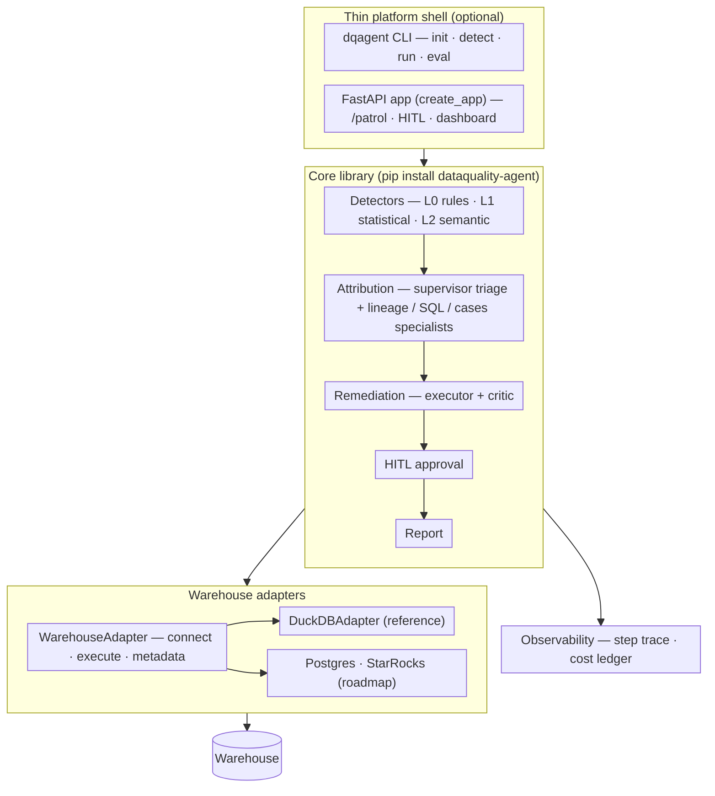

# Architecture

DataAgent follows the **dbt model**: a pluggable core library with thin platform shell and swappable warehouse connectors. You can `pip install` the core and drive it from Python, or run the bundled CLI and API shell. The kernel never talks to a warehouse directly — every read goes through one interface.

## The three layers

### Thin platform shell

`dqagent` (the CLI) and the FastAPI app (`create_app` — `/patrol` + HITL + dashboard) are a convenience layer. Everything they do is a thin call into the core, so you can embed the same behavior in your own scheduler or platform. (A `dqagent serve` command that wraps `uvicorn` is on the roadmap.)

### Core library

Four stages, each pluggable:

- **Detectors** — L0 deterministic rules, L1 statistical observability, L2 LLM semantics.
- **Attribution** — a supervisor triages each anomaly to a focused specialist (lineage, SQL, case retrieval) and aggregates their findings into a root-cause diagnosis.
- **Remediation** — an executor proposes fixes; a critic risk-grades them.
- **HITL + report** — high-risk fixes pause for human approval; the result is a structured report.

### Warehouse adapters

The `WarehouseAdapter` protocol (`connect` / `execute` / `list_tables` / `describe_table` / `row_count`) is the **only** way the core reads a warehouse. DuckDB ships as the reference implementation; Postgres and StarRocks are on the connector roadmap. See [Warehouse adapter](/docs/reference/warehouse-adapter).

## Four pluggable seams

The architecture exposes four extension points — one per stage boundary. You connect your warehouse, add your checks, teach it your fixes, and inject your domain knowledge **without forking the core**. See [Extension points](/docs/concepts/extension-points).
