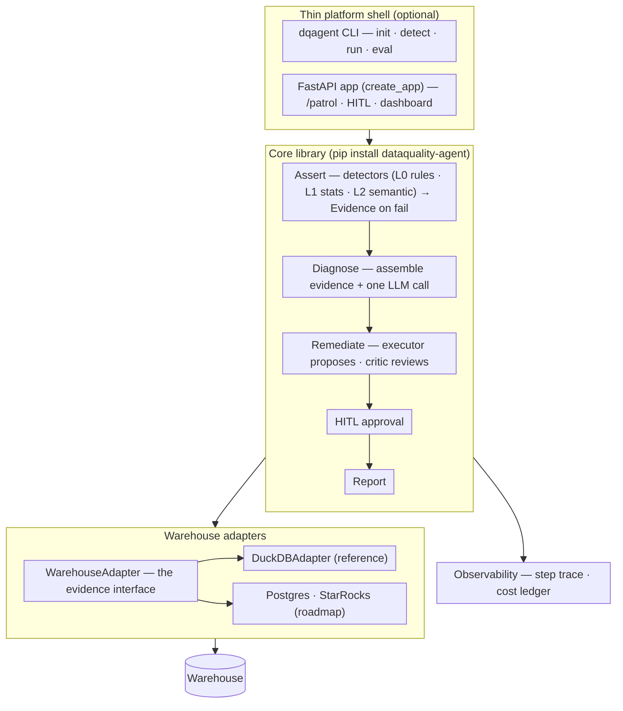

# Architecture

DataAgent follows the **dbt model**: a pluggable core library with a thin platform shell and swappable warehouse connectors. You can `pip install` the core and drive it from Python, or run the bundled CLI and API shell. The kernel never talks to a warehouse directly — every read goes through one interface, and every judgment travels with its evidence.

## One thing, verified repeatedly

The core runs a linear graph of five stages — but they are not five modules. They are **one assertion being repeatedly verified**, with evidence moving between stages as a first-class object:

| Stage | Node | What it does |
|---|---|---|
| assert | `inspect` | runs L0/L1/L2 detectors; each failing assertion captures `Evidence` (query + offending rows + expected vs actual) |
| diagnose | `diagnose` | deterministically assembles an evidence package (anomaly evidence + lineage + schema + similar cases), then makes **one** LLM call to attribute root cause |
| remediate | `remediate` | an executor proposes a fix; a critic (deterministic rule gate + LLM) reviews it |
| approve | `approve` | high-risk fixes pause for a human (HITL interrupt, persisted) |
| report | `report` | emits the structured report — anomalies, diagnoses, proposals, approvals, and eval metrics |

See [Core flow](/docs/concepts/core-flow) for the stage-by-stage walk.

## The three layers

### Thin platform shell

`dqagent` (the CLI) and the FastAPI app (`create_app` — `/patrol` + HITL + dashboard) are a convenience layer. Everything they do is a thin call into the core, so you can embed the same behavior in your own scheduler or platform. (A `dqagent serve` command that wraps `uvicorn` is on the roadmap.)

### Core library

The core is the assertion lifecycle described above. Every stage boundary is a pluggable seam, so each stage can be replaced or extended without forking the rest.

### Warehouse adapters

The `WarehouseAdapter` protocol (`connect` / `execute` / `list_tables` / `describe_table` / `row_count`) is the **only** way the core reads a warehouse — and in the philosophy, it is the *evidence interface*: it exposes what it can query and pulls on demand, never dumping metadata into context. DuckDB ships as the reference implementation; Postgres and StarRocks are on the connector roadmap. See [Warehouse adapter](/docs/reference/warehouse-adapter).

## Four pluggable seams

The architecture exposes four extension points — one per stage boundary. You connect your warehouse, add your checks, teach it your fixes, and inject your domain knowledge **without forking the core**. See [Extension points](/docs/concepts/extension-points).
