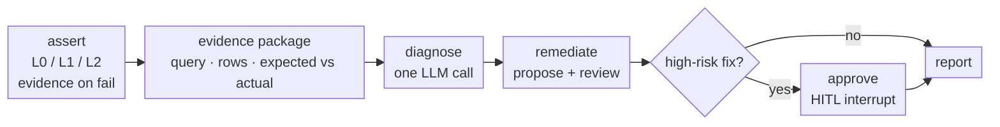

# Core flow

A patrol is one pass through the graph. It starts with an assertion and ends with a report, pausing only when a high-risk fix needs a human decision. Evidence is captured on failure and travels with every later judgment.

## Stage by stage

### 1. assert (inspect)

Runs every registered detector across three layers — L0 rules, L1 statistical, L2 semantic. Each is an **assertion**: a declaration of "what's good" plus a computed verdict. When a detector fails, it captures structured `Evidence` — the triggering SQL, up to 20 offending rows, and expected-vs-actual. A single detector failing never aborts the patrol: its stage is isolated and marked failed.

### 2. evidence

The evidence is a first-class object, not a side note. It carries the query, the offending rows (capped at 20), the expected and actual values, and — where lineage is known — the upstream tables in the blast radius.

### 3. diagnose (thin agent)

Attribution is **thin by design**. A deterministic step assembles an evidence package from four sources — the anomaly's own evidence, its upstream lineage, its table schema, and similar past cases — each source independently guarded so one failure never breaks the package. Then a **single LLM call** turns that package into a structured `Diagnosis` (root-cause category + confidence), with the evidence attached.

There is no triage and no specialist tool-loop: the LLM reads the evidence package and produces one evidence-backed conclusion. An anomaly with no evidence degrades to "unknown" without spending an LLM call at all.

### 4. remediate

An **executor** proposes a fix for each diagnosis; a **critic** reviews it. The critic runs a deterministic rule gate first (dangerous SQL, unknown tables, mislabeled risk) and only sends what rules cannot judge to the LLM. A rejected fix is rewritten with the feedback, up to a bounded number of rounds; if it still fails, it is force-graded high-risk so it cannot silently pass.

### 5. approve (HITL)

If any remediation requires approval, the graph **interrupts** and waits. A human approves or rejects each high-risk fix. The paused state is persisted, so a restart resumes exactly where it stopped.

### 6. report

Emits the structured report: anomalies, diagnoses, proposed fixes, approvals, and every metric that feeds the evaluation harness.

## Why this shape

The shape follows the two axioms that matter most:

- **Determinism first** — the deterministic stages (assert, evidence assembly, the rule gate) filter out the noise before the LLM ever runs, so the LLM is reserved for the small part only it can do.
- **Evidence first** — every conclusion downstream of a failed assertion is tied to the evidence that justified it, which is what makes attribution and remediation auditable and evaluable.

See [Philosophy](/docs/philosophy) for the worldview this implements.
