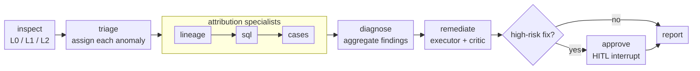

# Core flow

A patrol is a single pass through the supervisor graph. It starts with detection and ends with a report, pausing only when a high-risk fix needs a human decision.

## Stage by stage

### 1. inspect

Runs every registered detector across three layers — L0 rules, L1 statistical, L2 semantic — and collects anomalies. A single detector failing never aborts the patrol: its stage is isolated and marked failed.

### 2. triage

The supervisor assigns **each anomaly** to exactly one specialist. An anomaly about a broken join goes to the lineage specialist; a suspicious value pattern goes to SQL; a known failure signature goes to case retrieval.

### 3. attribution specialists

Three specialists run, each handling only the anomalies assigned to it:

- **lineage** — walks the lineage graph to find where the bad data originated.
- **sql** — inspects the schema and queries the data to confirm the hypothesis (read-only, via `SafeSQL`).
- **cases** — retrieves similar past incidents from the case store (RAG).

### 4. diagnose

Aggregates the specialists' findings into one structured root-cause diagnosis per anomaly, with a confidence score.

### 5. remediate

An **executor** proposes a fix for each diagnosis; a **critic** grades its risk. Low-risk fixes (reversible — dedup, value-range) go straight to the report. High-risk fixes (data-loss — deleting rows, nulling columns) are flagged.

### 6. approve (HITL)

If any remediation requires approval, the graph **interrupts** and waits. A human approves or rejects each high-risk fix. The paused state is persisted, so a restart resumes exactly where it stopped.

### 7. report

Emits the structured report: anomalies, diagnoses, proposed fixes, approvals, and every metric that feeds the evaluation harness.

## Why the split matters

Separating **detection** (deterministic, cheap) from **attribution** (LLM, expensive) from **remediation** (risky, human-gated) keeps the pipeline fast and safe: deterministic layers filter out the noise before the LLM ever runs, and the human gate is reserved for the small set of fixes that can actually destroy data.
