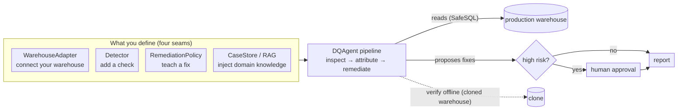

# Extension points & permissions

DQAgent is a framework, not a hardcoded script. Four seams let you define **your** warehouse, **your** checks, **your** fixes, and **your** domain knowledge — and a permission model keeps the agent out of the one place it must never write.

## The four seams

| Seam | What you implement | Example |
|---|---|---|
| `WarehouseAdapter` | `connect` / `execute` / `list_tables` / `describe_table` / `row_count` | Point the core at Postgres instead of DuckDB |
| `Detector` | `name` + `detect(adapter, ctx) -> list[Anomaly]` | "alert when `orders.gmv` drops 3σ below baseline" |
| `RemediationPolicy` | how to turn a diagnosis into a fix, and its risk | "a duplicate row → `DELETE` (reversible)" |
| `CaseStore` / RAG | a store of past incidents to retrieve | "this null-spike looks like last week's upstream job failure" |

Each seam is a small protocol, and the core ships with a working reference for each — see the [How-to guides](/docs/how-to/connect-a-warehouse). For the five generic L0 check types, the `Detector` seam has a shortcut: **declare** them in YAML instead of writing a detector — see [Declarative L0 assertions](/docs/reference/detectors#declarative-l0-assertions).

## The permission model

The boundary is **who may write**, and it is enforced at three points:

1. **Reads are read-only.** Every agent SQL goes through `SafeSQL`: SELECT-only, a table whitelist, and a row cap. The core cannot write even by accident.
2. **High-risk fixes need a human.** A fix that can lose data (`DELETE`, nulling a column) pauses the pipeline at a HITL interrupt. Only a human's explicit approval lets it proceed — and that approval is recorded in the report.
3. **Verification happens offline.** Proposed fixes are applied to a **cloned** warehouse to measure remediation success, never to production.

The result: the agent proposes and verifies; the human decides and executes. Your warehouse is never mutated by the agent itself.
